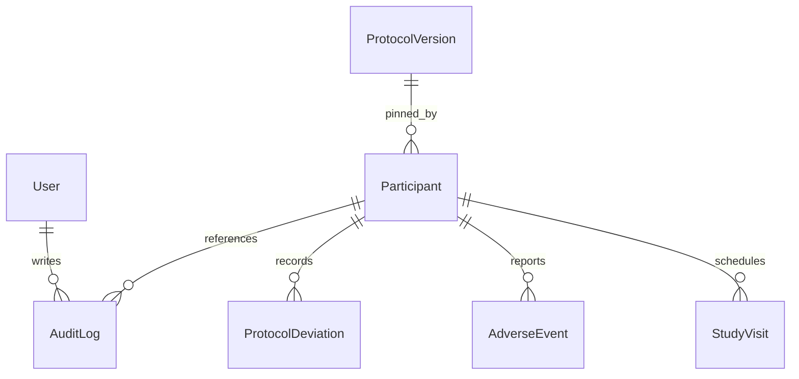

# Domain Model

## Entities

- `User`
  Schema/model file: [prisma/schema.prisma](/c:/Users/Owner/Desktop/ww11/prisma/schema.prisma) — `model User`
  Primary service owner: [src/lib/auth/session.ts](/c:/Users/Owner/Desktop/ww11/src/lib/auth/session.ts) — `getSessionFromRequest()`

- `ProtocolVersion`
  Schema/model file: [prisma/schema.prisma](/c:/Users/Owner/Desktop/ww11/prisma/schema.prisma) — `model ProtocolVersion`
  Primary service owner: [src/services/protocolService.ts](/c:/Users/Owner/Desktop/ww11/src/services/protocolService.ts) — `createProtocolVersion()` and `activateProtocolVersion()`

- `Participant`
  Schema/model file: [prisma/schema.prisma](/c:/Users/Owner/Desktop/ww11/prisma/schema.prisma) — `model Participant`
  Primary service owner: [src/services/participantService.ts](/c:/Users/Owner/Desktop/ww11/src/services/participantService.ts) — `createScreeningParticipant()`, `enrollParticipant()`, `getParticipantDetail()`, and `completeStudy()`

- `StudyVisit`
  Schema/model file: [prisma/schema.prisma](/c:/Users/Owner/Desktop/ww11/prisma/schema.prisma) — `model StudyVisit`
  Primary service owner: [src/services/visitService.ts](/c:/Users/Owner/Desktop/ww11/src/services/visitService.ts) — `completeVisit()`

- `AdverseEvent`
  Schema/model file: [prisma/schema.prisma](/c:/Users/Owner/Desktop/ww11/prisma/schema.prisma) — `model AdverseEvent`
  Primary service owner: [src/services/safetyEventService.ts](/c:/Users/Owner/Desktop/ww11/src/services/safetyEventService.ts) — `recordAdverseEvent()`

- `ProtocolDeviation`
  Schema/model file: [prisma/schema.prisma](/c:/Users/Owner/Desktop/ww11/prisma/schema.prisma) — `model ProtocolDeviation`
  Primary service owner: [src/services/safetyEventService.ts](/c:/Users/Owner/Desktop/ww11/src/services/safetyEventService.ts) — `recordDeviation()`

- `AuditLog`
  Schema/model file: [prisma/schema.prisma](/c:/Users/Owner/Desktop/ww11/prisma/schema.prisma) — `model AuditLog`
  Primary service owner: [src/services/auditService.ts](/c:/Users/Owner/Desktop/ww11/src/services/auditService.ts) — `record()`

## Key Relationships

- Participants pin to a single protocol version through `pinnedProtocolVersionId` in [prisma/schema.prisma](/c:/Users/Owner/Desktop/ww11/prisma/schema.prisma). The enrollment workflow that sets it lives in `participantService.enrollParticipant()` in [src/services/participantService.ts](/c:/Users/Owner/Desktop/ww11/src/services/participantService.ts).
- Visit schedules are derived from a protocol version’s `visitTemplates` and the participant’s `enrolledAt` timestamp in `buildScheduledVisits()` in [src/lib/domain/protocolRules.ts](/c:/Users/Owner/Desktop/ww11/src/lib/domain/protocolRules.ts).
- Safety data is participant-owned. `recordAdverseEvent()` and `recordDeviation()` in [src/services/safetyEventService.ts](/c:/Users/Owner/Desktop/ww11/src/services/safetyEventService.ts) both verify the participant first through [src/repositories/participantRepository.ts](/c:/Users/Owner/Desktop/ww11/src/repositories/participantRepository.ts).
- Audit logs are append-only and written through `auditService.record()` in [src/services/auditService.ts](/c:/Users/Owner/Desktop/ww11/src/services/auditService.ts), then queried through `auditRepository.listByParticipantId()` in [src/repositories/auditRepository.ts](/c:/Users/Owner/Desktop/ww11/src/repositories/auditRepository.ts).
