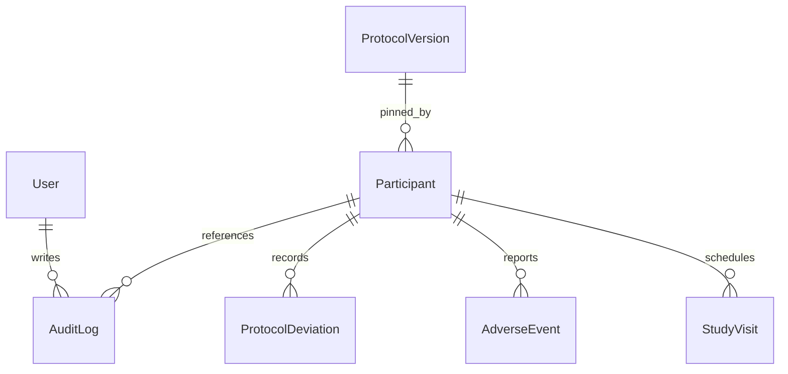

# Domain Model



## Entities

- `User`
  Schema/model file: [prisma/schema.prisma](../../prisma/schema.prisma) — `model User`
  Primary service owner: [src/lib/auth/session.ts](../../src/lib/auth/session.ts) — `getSessionFromRequest()`

- `ProtocolVersion`
  Schema/model file: [prisma/schema.prisma](../../prisma/schema.prisma) — `model ProtocolVersion`
  Primary service owner: [src/services/protocolService.ts](../../src/services/protocolService.ts) — `createProtocolVersion()` and `activateProtocolVersion()`

- `Participant`
  Schema/model file: [prisma/schema.prisma](../../prisma/schema.prisma) — `model Participant`
  Primary service owner: [src/services/participantService.ts](../../src/services/participantService.ts) — `createScreeningParticipant()`, `enrollParticipant()`, `getParticipantDetail()`, and `completeStudy()`

- `StudyVisit`
  Schema/model file: [prisma/schema.prisma](../../prisma/schema.prisma) — `model StudyVisit`
  Primary service owner: [src/services/visitService.ts](../../src/services/visitService.ts) — `completeVisit()`

- `AdverseEvent`
  Schema/model file: [prisma/schema.prisma](../../prisma/schema.prisma) — `model AdverseEvent`
  Primary service owner: [src/services/safetyEventService.ts](../../src/services/safetyEventService.ts) — `recordAdverseEvent()`

- `ProtocolDeviation`
  Schema/model file: [prisma/schema.prisma](../../prisma/schema.prisma) — `model ProtocolDeviation`
  Primary service owner: [src/services/safetyEventService.ts](../../src/services/safetyEventService.ts) — `recordDeviation()`

- `AuditLog`
  Schema/model file: [prisma/schema.prisma](../../prisma/schema.prisma) — `model AuditLog`
  Primary service owner: [src/services/auditService.ts](../../src/services/auditService.ts) — `record()`

## Key Relationships

- Participants pin to a single protocol version through `pinnedProtocolVersionId` in [prisma/schema.prisma](../../prisma/schema.prisma). The enrollment workflow that sets it lives in `participantService.enrollParticipant()` in [src/services/participantService.ts](../../src/services/participantService.ts).
- Visit schedules are derived from a protocol version’s `visitTemplates` and the participant’s `enrolledAt` timestamp in `buildScheduledVisits()` in [src/lib/domain/protocolRules.ts](../../src/lib/domain/protocolRules.ts).
- Safety data is participant-owned. `recordAdverseEvent()` and `recordDeviation()` in [src/services/safetyEventService.ts](../../src/services/safetyEventService.ts) both verify the participant first through [src/repositories/participantRepository.ts](../../src/repositories/participantRepository.ts).
- Audit logs are append-only and written through `auditService.record()` in [src/services/auditService.ts](../../src/services/auditService.ts), then queried through `auditRepository.listByParticipantId()` in [src/repositories/auditRepository.ts](../../src/repositories/auditRepository.ts).

---

## Two definitions of the same model

The model exists twice, and the code only runs one of them:

| Concern | Runtime (TypeScript + mock DB) | Design (`prisma/schema.prisma`) |
|---|---|---|
| Types | `src/types/domain.ts:11-174` | enums `:18-58`, models `:60-185` |
| Dates | ISO-8601 **strings** (for example `enrolledAt: string \| null`, `domain.ts:73`) | `DateTime` columns |
| `visitTemplates` | typed `VisitTemplate[]` (`domain.ts:58`) | untyped `Json` (`schema.prisma:79`) |
| `screeningNumber` unique | service check `participantService.ts:117-123` | `@unique` (`schema.prisma:93`) |
| `studySubjectId` unique | service check `participantService.ts:176-182` | `@unique` (`schema.prisma:94`) |
| `(protocolCode, versionNumber)` unique | service check `protocolService.ts:39-46` | `@@unique` (`schema.prisma:88`) |
| `(participantId, visitCode)` unique | **nothing** | `@@unique` (`schema.prisma:137`) |
| Foreign keys | none. Ids are plain strings | `@relation` on visits, events, deviations, audit (`schema.prisma:109,135,154,168,181-182`) |
| Sites | `siteId: string` on `Participant`, `siteIds: string[]` on `User` | same. There is **no `Site` model** |

The `(participantId, visitCode)` gap is load-bearing. A protocol version whose templates repeat a `visitCode` passes Zod (`src/lib/validation/protocolSchemas.ts:27` only requires `.min(1)`) and the service. Each template becomes a visit with id `` `${args.participantId}-${template.visitCode}` `` (`src/lib/domain/protocolRules.ts:39`), so two visits share an id. **Verified (ran), Finding F6:** after enrolling onto such a version, completing `participant-002-BASE` twice leaves statuses `["COMPLETED", "SCHEDULED"]`. `visitRepository.update()` finds the first match by `visitId` alone (`src/repositories/visitRepository.ts:32`). `completeStudy` then rejects forever. With Prisma the insert would fail instead, which is better but still a 500 at enrollment time.

## Entity reference

### Participant (`src/types/domain.ts:64-81`)

| Field | Set by | Line |
|---|---|---|
| `id` | `nextId("participant")`, for example `participant-k3j9x0ab` | `src/repositories/participantRepository.ts:49` |
| `status` | `"SCREENING"` on create, then `"ENROLLED"` or `"COMPLETED"` | `participantRepository.ts:51`, `participantService.ts:188,238` |
| `studySubjectId`, `enrolledAt`, `pinnedProtocolVersionId`, `blindedRandomizationCode`, `actualTreatmentArm` | `null` on create, written once by enrollment | `participantRepository.ts:50-56`, `participantService.ts:186-194` |
| `completedAt` | `completeStudy` | `participantService.ts:239` |
| `updatedAt` | every `update()` | `participantRepository.ts:75-78` |

Spread-order subtlety: `create()` writes the defaults first and spreads `...input` last (`participantRepository.ts:48-60`). The `Omit<…>` input type at `:46` is the only thing stopping a caller from overriding `status` or `id`. It is a compile-time guard only (and object-literal excess-property checks are its strongest form). At runtime an extra `status` key would win.

### ProtocolVersion (`src/types/domain.ts:51-62`)

- Created as `"DRAFT"` (`src/repositories/protocolRepository.ts:36`) with id `nextId(` `` `protocol-${input.protocolCode.toLowerCase()}-v${input.versionNumber}` `` `)` (`:35`). A created v3 therefore has an id like `protocol-acme-1-v3-<random>`, while the seeded ones are exactly `protocol-acme-1-v1` and `protocol-acme-1-v2` (`src/lib/mock-db/seed.ts:53,98`).
- `findAll()` sorts by `versionNumber` **descending** across all protocol codes (`protocolRepository.ts:16-18`). With more than one protocol code, the versions of different studies interleave.
- `activate()` (`:46-79`) sets the target to `ACTIVE` and every other `ACTIVE` sibling with the same `protocolCode` to `RETIRED`. **Verified (ran):** after creating and activating v3, the statuses are `1:RETIRED, 2:RETIRED, 3:ACTIVE`. A `DRAFT` sibling stays `DRAFT`.

### StudyVisit (`src/types/domain.ts:83-99`)

`protocolCode` on a visit is not the protocol code. It is a label like `ACME-1-v2` built at `protocolRules.ts:41`: `` `${args.protocolVersion.protocolCode}-v${args.protocolVersion.versionNumber}` ``. Do not join on it.

### AdverseEvent / ProtocolDeviation / AuditLog

These are append-only in practice: no repository exposes update or delete (`src/repositories/eventRepository.ts:15-49`, `src/repositories/auditRepository.ts:15-31`). `AuditLog.participantId` is `null` for protocol events (`src/services/protocolService.ts:58,82`), so protocol activation history is written but **no endpoint reads it**. `auditRepository` only has `listByParticipantId` (`auditRepository.ts:16-20`).

## Lifecycle state machines (what is reachable today)

```text
Participant:  SCREENING --enroll--> ENROLLED --completeStudy--> COMPLETED
              (SCREEN_FAILED, WITHDRAWN: declared at domain.ts:33,35; no code path sets them)

Visit:        SCHEDULED --completeVisit--> COMPLETED
              (MISSED, CANCELLED: declared at domain.ts:38; no code path sets them)

Protocol:     DRAFT --activate--> ACTIVE --(sibling activated)--> RETIRED
              ACTIVE --activate--> ACTIVE   (allowed: re-activation is not rejected)
```

Guards (all in `src/lib/domain/stateTransitions.ts` unless noted):

| Transition | Guard | Line |
|---|---|---|
| enroll | participant `SCREENING` **and** version `ACTIVE` | `:13-21` |
| complete visit | participant `ENROLLED` **and** visit `SCHEDULED` | `:23-31` |
| complete study | participant `ENROLLED` **and** every visit `COMPLETED` | `:33-46` |
| activate | version exists **and** is not `RETIRED` | `src/lib/domain/protocolRules.ts:58-73` |

**Verified (ran):** `assertProtocolVersionCanBeActivated(seed, "protocol-acme-1-v2")` returns the already-`ACTIVE` version, and activating it again writes a fresh `PROTOCOL_VERSION_ACTIVATED` audit row.

Finding F7: the completion guard filters with `visit.status !== "COMPLETED"` (`stateTransitions.ts:38`) and never reads `VisitTemplate.required` (`domain.ts:48`). Every seeded template has `required: true`, so the gap is invisible in the demo. It matters as soon as an optional visit is defined, or as soon as `MISSED` becomes reachable. A pure check with one `CANCELLED` visit confirms that the participant cannot complete.

## The seed, explained

`src/lib/mock-db/seed.ts` contains 5 users (`:13-49`), 2 protocol versions (`:51-142`), 3 participants (`:144-199`), 8 visits (`:201-338`), 1 adverse event (`:340-354`), 1 deviation (`:356-368`) and 1 audit row (`:370-384`), counted by reading the arrays.

| Participant | Site | Status | Pinned | Visits (status) |
|---|---|---|---|---|
| `participant-001` | site-101 | ENROLLED | v1 (now RETIRED) | BASELINE ✓, WEEK4 ✓, WEEK8 scheduled, CLOSEOUT scheduled |
| `participant-002` | site-101 | SCREENING | — | none |
| `participant-003` | site-202 | ENROLLED | v2 (ACTIVE) | BASELINE ✓, WEEK2 ✓, WEEK6 scheduled, CLOSEOUT scheduled |

The point of the seed is that `participant-001` stays on v1's WEEK4/WEEK8 schedule even though v2 (WEEK2/WEEK6) is active.

**Verified (ran), check C1:** for all 8 seeded visits, `buildVisitDates(participant.enrolledAt, template)` reproduces `targetDate`, `windowStart` and `windowEnd` exactly. Worked example: `participant-001` enrolled `2026-01-15T09:00:00.000Z`. WEEK4 has `dayOffset: 28, windowBeforeDays: 3, windowAfterDays: 5` (`seed.ts:69-74`), so the target is `2026-02-12T09:00`, the window starts `2026-02-09T09:00` and ends `2026-02-17T09:00` (`seed.ts:226-228`). Note that the window is computed from the **target**, not from enrollment:

```ts
export function buildVisitDates(enrollmentDate: string, template: VisitTemplate) {
  const targetDate = addDays(enrollmentDate, template.dayOffset);

  return {
    targetDate,
    windowStart: addDays(targetDate, -template.windowBeforeDays),
    windowEnd: addDays(targetDate, template.windowAfterDays)
  };
}
```

(`src/lib/domain/protocolRules.ts:19-27`.) `addDays` adds `offset * MS_PER_DAY` milliseconds (`:13-17`). That is UTC arithmetic, so there are no DST shifts. "Day 28" is exactly 28×24 hours after the enrollment *instant*, including its time of day.

Seed-data observation (read, not a code bug): the deviation `dev-001` says "Week 4 labs processed 1 day late." with `occurredAt: 2026-02-13` (`seed.ts:362-363`). The WEEK4 visit itself was completed on `2026-02-12T10:00` (`seed.ts:230`), inside its window. The deviation is about lab processing, not the visit.

## Debugging scenarios

| Symptom | Where to look | Cause |
|---|---|---|
| A newly enrolled participant's visits are off by hours from what you expected | `src/lib/domain/protocolRules.ts:15-17` | dates keep the enrollment time of day. `enrolledAt` is a full timestamp (`participantSchemas.ts:23`) |
| Two visits render with the same React key warning on the detail page | `ParticipantDetailView.tsx:83` (`key={visit.id}`) + `protocolRules.ts:39` | duplicate `visitCode` in the pinned version (Finding F6) |
| Writes vanish after a dev-server restart | `src/lib/mock-db/store.ts:44-52` | in-memory state, re-cloned from the seed on module load |
| A test passes alone but fails after another test | `store.ts:58-66` | a test file is missing `beforeEach(resetMockDb)`. `permission-enforcement.test.ts` has none, which is fine only because it never writes |
| Participant list shows "No scheduled visit" for a participant with visits | `src/services/participantService.ts:50-52` | every visit is `COMPLETED`. Only `SCHEDULED` visits count |

## Exercise ladder (Goal + Check)

1. **Junior.** *Goal:* compute by hand the WEEK6 window for `participant-003`. *Check:* `2026-04-12T08:30` to `2026-04-20T08:30`, target `2026-04-16T08:30`, matching `seed.ts:311-313`.
2. **Junior.** *Goal:* list which `ParticipantStatus` values are reachable. *Check:* three values (SCREENING, ENROLLED, COMPLETED), and `grep -rn '"WITHDRAWN"' src` hits only `src/types/domain.ts`.
3. **Mid.** *Goal:* reject duplicate `visitCode`s at the validation boundary. *Check:* a `.superRefine` (or equivalent) on `createProtocolVersionSchema` rejects `[{visitCode:"BASE"},{visitCode:"BASE"}]`. Not runnable here without `zod`, so pair it with a service-level guard you *can* test with `node --test`.
4. **Mid.** *Goal:* make study completion respect `VisitTemplate.required`. *Check:* you will find that `StudyVisit` does not copy `required` from the template (`protocolRules.ts:38-54`), so you must either add it at materialization or look up the pinned version. Your test enrolls onto a version with an optional visit and completes the study without that visit.
5. **Senior.** *Goal:* write the Prisma migration plan for this model (string dates to `DateTime`, `Json` templates, missing `Site`). *Check:* your plan names the enforcement that moves from service checks to constraints (the uniqueness rows in the first table) and keeps the friendly 409 messages by catching `P2002`.
